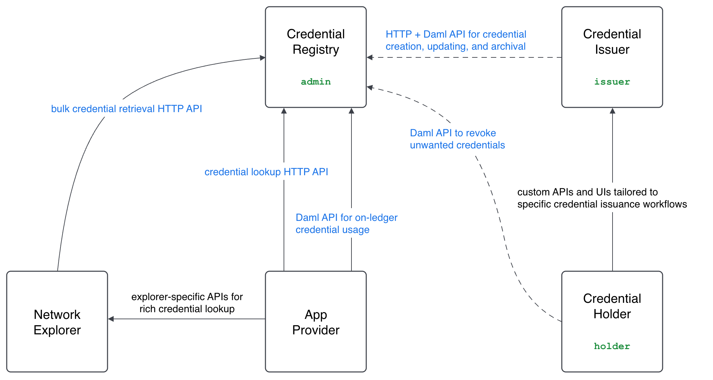

<pre>
  CIP: TBD
    Note: all `cip-tbd` identifiers in this document are placeholders and should be replaced with the actual CIP number once assigned.
  Layer: Daml
  Title: Canton Network Credentials Standard
  Author:
    PixelPlex, Simon Meier
  License: CC0-1.0
  Status: Draft
  Type: Standards Track
  Created: 2026-11-03
</pre>

FIXME:
- diagram: show the two modification APIs as optional APIs with dashed arrows
- code:
  - adjust reference implementation to match code shown in here
  - split the HTTP API definitions into the read-only HTTP API and the factory HTTP API, which is optional
    - preferred option: in splice repo
      - `/credential-standard/splice-api-credential-registry-v1.yaml` (read-only)
      - `/credential-standard/splice-api-credential-registry-update-v1.yaml` (modification)
    - then update all OpenAPI links in this CIP, which currently all point to the single `openapi/credential-registry-v1.yaml`
    - add the missing spec link for the [Bulk Credential Retrieval API](#bulk-credential-retrieval-api)
      (note though that bulk retrieval is part of read-only API)
    - add the spec link for the factory context endpoint in [Credential Factory Interface](#credential-factory-interface)
  - move the Splice Credential Registry implementation out of ANS into a separate package/module (e.g., `Splice.Credentials`)

## Abstract

Define standard APIs for storing, retrieving, and using credentials on the Canton Network;
and use these to solve application discovery and party metadata discovery on the Canton Network.

## Specification

The specification of this CIP consists of three parts:

1. **Credential Registry APIs**: defines standard APIs for storing, retrieving, and using Canton Network credentials.
2. **Splice Credential Registry**: specifies how these APIs are implemented in a decentralized registry run by the SV nodes as part of the Global Synchronizer. This registry serves as the base registry from which application discovery can start.
3. **Standardized Application and Metadata Discovery**:
   specifies how these APIs and the Splice Credential Registry are used to standardize the discovery of specific
   kinds of applications on the network and their metadata
   such as the off-ledger APIs of [CIP-0056 asset registries](../cip-0056/cip-0056.md#off-ledger-api-discovery-and-access).

We provide details on each of these parts in the following subsections
after giving a high-level overview of the roles and interactions involved.

### High-Level Overview

This standard is concerned with entities and apps acting in the following roles:

- **credential issuers**: entities that issue credentials and back their veracity
- **credential holders**: entities that hold credentials and agree to the credential's claims
- **credential registry administrators**: entities that store and serve credentials, either published jointly by their issuer and holder or created by registry-internal workflows
- **network explorers**: entities building apps for exploring Canton Network activity and structure
- **app providers**: entities that operate apps that retrieve and use credentials in their UIs and/or in their on-ledger workflows
- **app users**: entities that use apps that use credentials

Entities often act in multiple roles. For example, a [CIP-0056 token administrator that self-publishes their off-ledger token registry URLs](../cip-0056/cip-0056.md#off-ledger-api-discovery-and-access) to the Splice Credential Registry acts both as the credential issuer and the credential holder of the corresponding credential. The claim in the credential associates the property `splice.lfdecentralizedtrust.org/registry-urls` to the actual URLs. Token Standard wallets are typical apps using credentials with that kind of property. They use them to resolve the admin party-ids encountered in tokens held by a wallet user to the [URLs to query to execute transfers and other actions](../cip-0056/cip-0056.md#utxo-access-management).

The following diagram shows how the APIs defined in this CIP mediate the interaction between the apps in the different roles. Arrows point from clients to servers of APIs.



As we can see, the APIs cover the interaction between the different kinds of apps and credential registries.
Standardized APIs are shown in blue and custom APIs are shown in black.
Credential holders use custom APIs and UIs to interact with credential issuers. App providers can use explorer-specific APIs for richer lookups, see [Rich Credential Lookup](#rich-credential-lookup). App users are not shown in the diagram as they do not directly interact with any of the APIs standardized in this CIP. They rely on the app provider making suitable choices with respect to how to use the standardized APIs to make use of credentials in the apps' UIs and on-ledger workflows.

The diagram does not show the [Credential Registry Info API](#credential-registry-info-api), which is used for extensibility. It allows apps interacting with the registry to figure out what standards the registry supports and what limits it enforces.

Note that there can be many credential registries in the network.
One of them is the [Splice Credential Registry](#splice-credential-registry),
which serves as a base credential registry for the network.
It is for example used to [discover the other credential registries in the network](#standardized-application-and-metadata-discovery).

Note also that credential registries are not required to support third-party credential issuers.
As explained below, the `CredentialFactory` API is an optional API.
This enables a simpler deployment model of Credential Issuer apps where their one app
serves the dual purpose of issuing credentials and serving the read-only Credential Registry APIs.

### Credential Registry APIs

#### Daml APIs

The Daml APIs mediate the on-ledger interactions of the different applications with the credential registry. They consist of the mandatory implementation of the `Credential` interface and an optional implementation of the `CredentialFactory` interface. We explain them in the following two sections. We specify the expected usage of these APIs by apps and wallets thereafter.

##### Credential Interface

The data schema of credentials is inspired by the [W3C Verifiable Credentials Data Model](https://www.w3.org/TR/vc-data-model-2.0/).
Concretely, it is defined by the following Daml code copied from the [reference implementation](#reference-implementation):

```haskell
-- | A claim that is part of a credential.
data Claim = Claim with
    subject : Text
      -- ^ The subject of the claim.
      --
      -- Often set to the textual representation of the holder party-id of the credential.
      --
      -- Subjects MUST only contain characters from [a-zA-Z0-9 ._:/-].
      -- Note that the space character is allowed as it is allowed in party names in Daml.
    property : Text
      -- ^ The property of the claim.
      --
      -- Properties MUST only contain characters from [a-zA-Z0-9._:/-].
      --
      -- All properties MUST be namespaced in the form `namespace/property` to avoid collisions.
      -- The namespace `cip-<nr>` is reserved for CIP-defined properties.
      -- All other applications MUST use a DNS name for a domain under their control.
      -- For example, a property `prop` defined by the domain `example.com` would be `example.com/prop`.
    value : Text
      -- ^ The value of the claim.
  deriving (Eq, Show)

-- | A view of a credential record stored in a credential registry.
data CredentialView = CredentialView with
    admin : Party
      -- ^ The party that administers this credential registry.
    issuer : Party
      -- ^ The party that issued the credential.
    holder : Party
      -- ^ The party that holds the credential.
    claims : [Claim]
      -- ^ The claims of the credential.
    validFrom : Optional Time
      -- ^ The time from which this credential is valid.
    validUntil : Optional Time
      -- ^ The time until which this credential is valid.
    createdAt : Optional Time
      -- ^ The time at which this credential record was created.
    expiresAt : Optional Time
      -- ^ The time at which this credential record expires in the registry.
      --
      -- The registry MAY archive the record after this time.
      --
      -- Separate from `validUntil`, as the expiry time of the
      -- credential record in the registry is determined by the registry policy and
      -- may differ from the validity period of the credential itself.
    revokableBy : [[Party]]
      -- ^ The groups of parties that are allowed to jointly revoke this credential.
      --
      -- The credential can be revoked by any one of these groups acting together.
      -- Wallets are expected to use this field to determine whether their user
      -- can call the `Credential_Revoke` choice on their own, i.e., whether
      -- one of the groups consists only of the user's party.
    meta : Metadata
      -- ^ Metadata associated with this credential record. Used for extensibility.
  deriving (Eq, Show)

-- | A credential record stored in a credential registry.
interface Credential where
  viewtype CredentialView

  credential_revokeImpl : ContractId Credential -> Credential_Revoke -> Update Credential_RevokeResult
  credential_getImpl : ContractId Credential -> Credential_Get -> Update CredentialView

  nonconsuming choice Credential_Revoke : Credential_RevokeResult
    -- ^ Revoke this credential record.
    --
    -- The choice is non-consuming to maximize implementation flexibility.
    -- Implementations MUST ensure that the credential is properly revoked according to the registry's policy.
    with
      actors : [Party]
        -- ^ The parties revoking the credential.
        --
        -- Registries MUST allow any group listed in `revokableBy` to revoke the credential.
        -- Registries SHOULD include both the holder and the issuer individually in `revokableBy`.
    controller actors
    do credential_revokeImpl this self arg

  nonconsuming choice Credential_Get : CredentialView
    -- ^ Fetch the view of the credential.
    --
    -- Registries MAY restrict the actor in case the credential is not public.
    --
    -- Callers SHOULD check that the fetched credential view matches their
    -- expectations, e.g., that it has the correct admin, holder and issuer.
    with
      actors : [Party]
        -- ^ The parties fetching the contract.
    controller actors
    do credential_getImpl this self arg

data Credential_RevokeResult = Credential_RevokeResult with
    archivedCredential : CredentialView
      -- ^ The view of the revoked credential. It is returned for convenience
      -- so that the caller does not need to fetch it ahead of time.
    meta : Metadata
      -- ^ Additional metadata specific to the revoke operation, used for extensibility.
  deriving (Eq, Show)
```

Credential registries MAY enforce limits on the credentials they store to avoid operational problems from overly large credentials. The limits are communicated to users via the [Credential Registry Info API](#credential-registry-info-api). See [Splice Credential Registry Limits](#splice-credential-registry-limits) for the concrete limits enforced by the Splice Credential Registry.

##### Credential Factory Interface

The purpose of this API is to enable credential issuers and holders to *jointly* create, update, and archive credentials in a third-party credential registry. Each credential registry MUST document whose authorization it requires to create a credential, and SHOULD require the authorization of both issuer and holder. The Splice Credential Registry requires both. The specific workflows for obtaining this authorization and determining the claims of the credential are provided by the issuer and implemented in their credential issuance app.

Implementing this API is optional for credential registries. They MAY decide to only support registry-internal workflows for creating credentials, and not offer third-party issuers the right to publish credentials to that registry.

This API uses the factory pattern pioneered in [CIP-0056](../cip-0056/cip-0056.md): the `CredentialFactory` Daml interface provides a choice `CredentialFactory_UpdateCredentials` that allows for a bulk update of credentials with the same issuer and holder. Each element of its `newCredentials` argument becomes one credential record with its claims and validity period. A corresponding HTTP API endpoint allows retrieval of the context to call that choice.

The specifications of the `Credential` and `CredentialFactory` Daml interfaces and of the HTTP API endpoint can be found here:

- [Splice/Api/Credential/RegistryV1.daml](https://github.com/hyperledger-labs/splice/pull/3416/changes#diff-808147bf36f1c087a42b92d67d2021c2ca203076cc0e3b6a31f2ccc60497a34d) (includes the data format of credentials)
- [openapi/credential-registry-v1.yaml](https://github.com/hyperledger-labs/splice/pull/3416/changes#diff-a73145dfdb26770f01b5fc0a9f35c7c34f067584acb6ec16de7e82040df6f835)

##### Expected App Usage of Daml APIs

We expect applications that need to fetch credentials as part of their Daml workflows to use `Credential_Get`.
We also expect wallets to be able to list all credentials held by their user by asking the user's validator node for all active contracts implementing the `Credential` interface. Wallets can let the user archive an unwanted credential using the `Credential_Revoke` choice, provided the credential's `revokableBy` field contains a group consisting only of the user's party. We also expect that wallets can let the user open the credential issuer's custom dApp for managing that credential. We expect them to be able to do so as explained in [Standardized Application and Metadata Discovery](#standardized-application-and-metadata-discovery).

Note that apps and users that want to use credentials from a specific registry on-ledger must vet the DAR files of that credential registry.

#### Read-Only HTTP APIs

Credential registries SHOULD serve the read-only HTTP APIs specified below.

##### Credential Registry Info API

The purpose of the credential registry info API is twofold:

1. It enables an asynchronous rollout of newer versions of the credential registry APIs.
2. It informs clients about constraints of the registry (e.g., limits on the number of claims or results).

The API is specified in [openapi/credential-registry-v1.yaml](https://github.com/hyperledger-labs/splice/pull/3416/changes#diff-a73145dfdb26770f01b5fc0a9f35c7c34f067584acb6ec16de7e82040df6f835).

##### Credential Lookup API

The credential lookup API serves queries of the form `(property, issuer?, holder?)`:

- `property` is required and matches the whole property of a claim, not a prefix.
- `issuer` and `holder` are optional. Each is a single party.

The API returns the credential records that contain at least one claim with that property. This is all that is needed for the lookups in [Standardized Application and Metadata Discovery](#standardized-application-and-metadata-discovery), and it keeps the indexing overhead for credential registries small. Richer queries are left to network explorers, see [Rich Credential Lookup](#rich-credential-lookup).

The API is specified in [openapi/credential-registry-v1.yaml](https://github.com/hyperledger-labs/splice/pull/3416/changes#diff-a73145dfdb26770f01b5fc0a9f35c7c34f067584acb6ec16de7e82040df6f835).
By default the API only returns the `CredentialView` of a credential. It optionally also includes the underlying contract so that it can be disclosed for usage in a Daml transaction that reads the credential.

###### Handling Duplicates

The API returns the record time of the transaction that created the credential contract.
Record time is the Canton protocol sequencing time of that transaction's confirmation request.
It orders the results by record time descending, with contract id ascending as the tie-break.

Clients that need to choose a single credential record can implement last-write-wins semantics by selecting the first record in the returned order whose validity period is effective,
i.e., the record with the latest record time, breaking ties by the smallest contract id.

Note that operations that re-create a record, such as an [extension of its expiration](#extended-expiration-durations),
produce a new contract with a new record time. Such a re-created record thus counts as the latest write,
even if its `createdAt` is older than that of other records with the same property.

##### Bulk Credential Retrieval API

The purpose of the bulk credential retrieval API is to enable network explorers to ingest all credentials of a registry as they are created, updated, and archived.

The corresponding HTTP endpoints work by exposing the list of synchronizers which are used by the registry to store credentials, and then serving pages of create and archive events per synchronizer in ascending record time order, with contract id ascending as the tie-break. A registry MAY prune the events of records that were archived more than 7 days ago, so an explorer that falls further behind starts over and receives the current records without their pruned history.

##### Rich Credential Lookup

Network explorers MAY offer richer lookups than the standardized [Credential Lookup API](#credential-lookup-api), for example by property prefix, by several issuers, or by subject.
They ingest credentials through the [Bulk Credential Retrieval API](#bulk-credential-retrieval-api) and build their own indexes. This CIP does not standardize such lookups, and the Splice Credential Registry does not serve them.

### Splice Credential Registry

Splice adds a decentralized base credential registry that is run by the SV nodes as part of the Global Synchronizer.
Its admin party is the `dso` party, and it implements all the APIs defined above, including the optional `CredentialFactory` API.

By default, there is no Canton Coin (CC) payment required for creating credential records in the registry.
Instead, the registry expires the records at the end of a free period of 90 days by default (configurable by SV voting),
so that the traffic cost of creating and renewing them covers their storage cost.
This CIP does not define automatic renewal. To keep a record beyond its `expiresAt`, its issuer and holder can either
jointly renew it without burning CC by re-creating it via the `CredentialFactory`, which results in a new `createdAt`,
or its issuer or holder can extend it by burning CC as described in [Extended Expiration Durations](#extended-expiration-durations).

#### Extended Expiration Durations

The registry supports extending the expiration of an existing record by burning CC.
The default fee is `1.0 USD/year` (configurable by SV voting).
An extension archives the record and creates a replacement with the same claims, the same `createdAt`, and a new `expiresAt`.

The holder or issuer can request such an extension on their own, as the extension does not change the claims of the credential.
They do so by initiating a Token Standard transfer where:

- `sender` is equal to the `issuer` or `holder` of the credential to extend
- `amount` is equal to the amount of CC to burn
- `receiver` is equal to the party `cip-tbd_credential-manager::1220000000000000000000000000000000000000000000000000000000000000abcd`
- `memo` is equal to `cip-tbd/memo:request=extend-credential-expiry`
- `extraArgs.context` stores the contract-id of the credential to be extended in `cip-tbd/credential-cid` as an `AV_ContractId`

Note that setting the contract-id in `extraArgs.context` requires wallet apps to support this feature explicitly.

The new expiry time is computed as follows:

```text
purchasedDuration = floor(amount * coin price / yearly fee * 365) days
newExpiresAt0     = max(expiresAt, transfer.requestedAt) + freePeriod + purchasedDuration
newExpiresAt      = min(newExpiresAt0, validUntil)    -- only if validUntil is set
```

where `transfer.requestedAt` is the wallet provided timestamp on the Token Standard transfer, which is checked to be in the past.
The registry rejects extension requests where `newExpiresAt` is not later than the current `expiresAt`,
so that no CC is burned without effect.

A paid extension also adds the free period, as that is de-facto covered by the traffic paid for the extension transaction.

#### Splice Credential Registry Limits

The Splice Credential Registry rejects records that are too large to index and serve from Scan.
It does not validate claim content.
Content checks are application-specific and would bind the registry to particular use cases.

A credential record is accepted by the Splice Credential Registry only if all of the following hold:

- it contains at most 32 claims.
- each claim property is at most 255 characters and each claim subject is at most 255 characters, so that a full party-id can appear as subject.
- each claim value is at most 2047 characters.
- if both are set, `validUntil` is later than `validFrom`; and if set, `validUntil` is later than `createdAt`.
  Note that `validFrom` may be earlier than `createdAt`, so that credentials can be registered even within their validity period.

The registry sets the initial `expiresAt` to `createdAt` plus the free period, capped at `validUntil` if that is set.

The size limits are advertised via the [Credential Registry Info API](#credential-registry-info-api). Other registries MAY choose different limits.


### Standardized Application and Metadata Discovery

Together the APIs defined in this CIP and the Splice Credential Registry enable
defining standard ways to discover applications and metadata about them.
It works by a CIP defining claim properties within the CIP's namespace together with
their purpose and expected usage.

This CIP defines the following properties:

- `cip-tbd/credential-registry-urls`: serves to discover the off-ledger credential registry API of a specific credential registry admin party `registryAdmin`.
  It is published by `registryAdmin` using a self-published credential (issuer = holder = `registryAdmin`) in the Splice Credential Registry,
  whose claim subject is the textual representation of `registryAdmin`'s party-id.
  It specifies a comma-separated list of URL prefixes for party `registryAdmin`. Clients append the paths of the credential registry OpenAPI to them, as for the CIP-0056 registry URLs.
  Multiple URLs are supported for decentralized registries, so that clients can implement BFT reads.

- `cip-tbd/credential-issuer-app-url`: serves to discover the [CIP-0103 dApp](../cip-0103/cip-0103.md) of a specific credential issuer party `issuer`. It is self-published by the `issuer` party (issuer = holder = `issuer`) in the Splice Credential Registry, with the claim subject being the textual representation of `issuer`'s party-id. The idea is that the users' wallets read the user's credentials from their node, and then query the Splice Credential Registry using `cip-tbd/credential-issuer-app-url` to discover the URL for the issuer-specific dApp to manage the user's credentials. We expect the wallet UI to offer a redirect to that dApp. Such redirects may add a `credential-cid=<contract-id>` query parameter to the URL to focus on a particular credential. Whether to offer such a UI is optional for credential issuers.

In general, the expectation is that all properties in a credential's claims have the form `namespace/property` and the namespaces are one of the following:

1. `cip-<nr>`: for properties defined in a CIP
2. `<dns-name>`: for properties defined by an organization that owns the DNS name `<dns-name>`. These namespaces can be freely used by organizations to define their own properties in a way that does not conflict with standardized properties from CIPs or properties defined by other organizations.

We expect future CIPs to define additional well-known properties for discovering applications and metadata of a particular kind.

#### Discovering CIP-0056 Registries

Token Standard registries use the same mechanism to publish the URLs of their off-ledger APIs using the property `splice.lfdecentralizedtrust.org/registry-urls` defined in CIP-0056.
This enables the automatic discovery of the off-ledger API URLs for token registries by wallets and apps as [described in CIP-0056](../cip-0056/cip-0056.md#off-ledger-api-discovery-and-access).

#### Discovering the Splice Credential Registry and Canton Coin Token Registry

The above properties will be used to make the Splice Credential Registry and the Canton Coin Token Registry discoverable by making the `dso` party publish a credential in the Splice Credential Registry with issuer = holder = admin = `dso` and claims

| Subject | Property | Value |
| --- | --- | --- |
| `dso` | `cip-tbd/credential-registry-urls` | `<scan-url1>,...,<scan-urlN>` |
| `dso` | `splice.lfdecentralizedtrust.org/registry-urls` | `<scan-url1>,...,<scan-urlN>` |

The Scan URLs are the ones published per network here: [https://canton.foundation/sv-network-status/](https://canton.foundation/sv-network-status/).
These URLs, or the Scan proxy of a validator node, serve as the bootstrap for discovery: clients use them to query the Splice Credential Registry.
The `dso` credential above serves to make the Splice Credential Registry discoverable in the same way as any other credential registry.
The SV app takes care of creating and updating this credential as the Scan URLs change over time.

## Motivation

There is no standardized way for application discovery on the Canton Network.
This is for example becoming a problem for the growing set of token registries on the network,
as the [approach to their off-ledger API discovery described in CIP-0056](../cip-0056/cip-0056.md#off-ledger-api-discovery-and-access)
cannot yet be implemented.
We also expect this application discovery problem to appear for other types of applications and services on the Canton Network.
This CIP solves application and service discovery on the Canton Network.

Furthermore, this CIP also provides a foundation for publishing and discovering metadata about parties on the Canton Network.
Therefore providing the building blocks for apps to improve their UX for displaying actors and counter-parties on the Canton Network.

## Rationale

### Focus on Public Credentials Only

This CIP covers credentials that can be discovered publicly. Public records are useful on their own, and they are how applications and explorers learn the shape of the network. Only public credentials can be indexed by explorers, and the bulk credential retrieval API is built for that ingest.

Private credentials are left to a future CIP. The `Credential_Get` choice already allows registries to restrict who can fetch a non-public credential, so that such a CIP can build on the interfaces defined here. That CIP would authenticate the users looking up credentials in a registry and return only the records those users are allowed to see. Standardizing access-control specifications on credentials published to a registry is a non-trivial effort. It is probably best done where the credential issuer and the registry are run by the same entity, so the registry can use custom rules for access control.

### No Self-Authenticating Credentials

TODO

### No Standardized Credential Verification

TODO


## Backwards Compatibility

This CIP is backwards compatible: it only adds functionality.

## Reference Implementation

The HTTP and Daml APIs and the Daml code for the Splice Credential Registry are available at [this Splice PR](https://github.com/hyperledger-labs/splice/pull/3416).

The Splice Credential Registry is expected to be implemented as follows:

1. The Splice Daml code is changed so that there is:
   1. A template that implements the `Credential` interface and serves to record credentials in the registry.
   2. An implementation of the `CredentialFactory`, so that issuers and holders can jointly publish credentials to the registry.
   3. A modified Token Standard `TransferFactory` implementation that supports burning CC for [paid extensions](#extended-expiration-durations).
2. The Scan app backend running on SV nodes implements the read-only HTTP APIs and the HTTP API of the `CredentialFactory`,
   so that any Scan app can be used to interact with the Splice Credential Registry.
   The Scan app internally builds an index over all credentials in its backing Postgres DB. A single multi-column index is sufficient,
   as the lookup API only supports one query pattern.
3. The Scan app proxy served by the validator app implements the same HTTP APIs, calling out to multiple Scan apps and comparing the results to implement BFT reads.


## Copyright

This CIP is licensed under CC0-1.0: [Creative Commons CC0 1.0 Universal](https://creativecommons.org/publicdomain/zero/1.0/)
