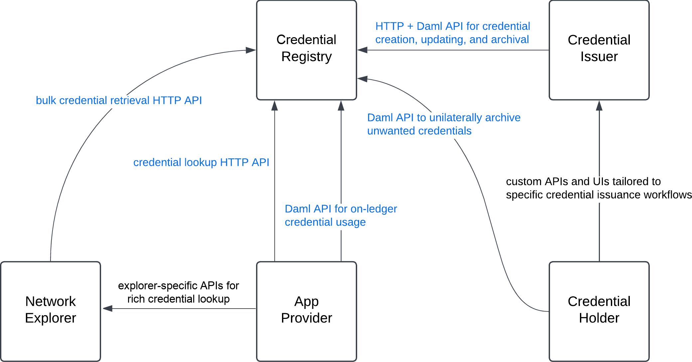

<pre>
  CIP: CIP TBD
  Layer: Daml
  Title: Canton Network Credentials Standard
  Author:
    PixelPlex, Simon Meier
  License: CC0-1.0
  Status: Draft
  Type: Standards Track
  Created: 2026-01-09
</pre>

## Abstract

Define standard APIs for storing, retrieving, and using credentials on the Canton Network.

## Specification

The specification of this CIP consists of three parts:

1. **Credential Registry APIs**: defines standard APIs for storing, retrieving, and using Canton Network credentials.
2. **DSO Credential Registry**: specifies how these APIs are implemented in a decentralized registry run across the SV nodes.
3. **Standardized Application and Metadata Discovery**:
   specifies how these APIs are used to standardize the discovery of specific
   kinds of applications on the network and their metadata
   such as the off-ledger APIs of [CIP-56 asset registries](https://github.com/global-synchronizer-foundation/cips/blob/main/cip-0056/cip-0056.md#off-ledger-api-discovery-and-access).

We provide details on each of these parts in the following subsections.

## Credential Registry APIs

The APIs are inspired by the [W3C Verifiable Credentials Data Model](https://www.w3.org/TR/vc-data-model-2.0/). This CIP uses them to store and look up credentials, and to discover the off-ledger APIs of a party. The discovery keys are specified in [Standardized Application and Metadata Discovery](#standardized-application-and-metadata-discovery).

### Overview

This standard is concerned with entities and apps acting in the following roles:

- **credential issuers**: entities that issue credentials and back their veracity
- **credential holders**: entities that hold credentials and agree to the credential's claims
- **credential registry administrators**: entities that store and serve credentials that were jointly published by their issuer and holder
- **network explorers**: entities building apps for exploring Canton Network activity and structure
- **app providers**: entities that operate apps that retrieve and use credentials in their UIs and/or in their on-ledger workflows
- **app users**: entities that use apps that use credentials

Entities often act in multiple roles. For example, a [CIP-56 token administrator that self-publishes their off-ledger token registry URLs](https://github.com/global-synchronizer-foundation/cips/blob/main/cip-0056/cip-0056.md#off-ledger-api-discovery-and-access) to the DSO Credential Registry acts both as the credential issuer and the credential holder of the corresponding credential. The claim in the credential would associate the property `splice.lfdecentralizedtrust.org/registry-urls` to the actual URLs. Token Standard wallets are typical apps using credentials with that kind of property. They use them to resolve the admin party-ids encountered in tokens held by a wallet user to the [URLs to query to execute transfers and other actions](https://github.com/global-synchronizer-foundation/cips/blob/main/cip-0056/cip-0056.md#utxo-access-management).

The following diagram shows how the APIs defined in this CIP mediate the interaction between the apps in the different roles. Arrows point from clients to servers of APIs.



As we can see, the APIs cover exactly the interaction between the different kinds of apps and credential registries. Credential holders use custom APIs and UIs to interact with credential issuers. App providers can use explorer-specific APIs for richer lookups, see [Rich Credential Lookup](#rich-credential-lookup). App users are not shown in the diagram as they do not directly interact with any of the APIs standardized in this CIP. They rely on the app provider making suitable choices with respect to how to use the standardized APIs to make use of credentials in the apps' UIs and on-ledger workflows.

The diagram does not show the [Credential Registry Info API](#credential-registry-info-api), which is used for extensibility. It allows apps interacting with the registry to figure out what standards the registry supports.

In the following subsections, we specify the different APIs. We conclude with a specification of the decentralized credential registry implemented by the SVs.

### Daml APIs

The Daml APIs mediate the on-ledger interactions of the different applications with the credential registry. They consist of the mandatory implementation of the `Credential` interface and an optional implementation of the `CredentialFactory` interface. We explain them in the following two sections. We specify the expected usage of these APIs by credential issuers and wallets thereafter.

#### Credential Interface

The schema of credentials is defined by the following Daml code (copied from the [draft PR](https://github.com/hyperledger-labs/splice/pull/3416/changes#diff-808147bf36f1c087a42b92d67d2021c2ca203076cc0e3b6a31f2ccc60497a34d)):

```haskell
-- | A claim that is part of a credential.
data Claim = Claim with
    subject : Optional Text
      -- ^ The subject of the claim.
      -- If not set, then the claim pertains to the holder of the credential.
      -- Implementations SHOULD leave it unset rather than set it to the holder.
      -- Subjects MUST only contain characters from [a-zA-Z0-9._:/-].
    property : Text
      -- ^ The property of the claim.
      --
      -- Properties MUST only contain characters from [a-zA-Z0-9._:/-].
      --
      -- All properties MUST be namespaced in the form `namespace/property` to avoid collisions.
      -- The namespace `cip-<nr>` is reserved for CIP-defined properties.
      -- All other applications MUST use a DNS name for a domain under their control.
      -- For example, a property `prop` defined by the domain `example.com` would be `example.com/prop`.
    value : Text
      -- ^ The value of the claim.
  deriving (Eq, Show)

-- | A view of a credential record stored in a credential registry.
data CredentialView = CredentialView with
    admin : Party
      -- ^ The party that administers this credential registry.
    issuer : Party
      -- ^ The party that issued the credential.
    holder : Party
      -- ^ The party that holds the credential.
    claims : [Claim]
      -- ^ The claims of the credential.
    validFrom : Optional Time
      -- ^ The time from which this credential is valid.
    validUntil : Optional Time
      -- ^ The time until which this credential is valid.
    createdAt : Optional Time
      -- ^ The time at which this credential record was created.
    expiresAt : Optional Time
      -- ^ The time at which this credential record expires in the registry.
      --
      -- The registry MAY archive the record after this time.
      --
      -- Separate from `validUntil`, as the expiry time of the
      -- credential record in the registry is determined by the registry policy and
      -- may differ from the validity period of the credential itself.
    meta : Metadata
      -- ^ Metadata associated with this credential record. Used for extensibility.
  deriving (Eq, Show)

-- | A credential record stored in a credential registry.
interface Credential where
  viewtype CredentialView

  credential_archiveAsHolderImpl : ContractId Credential -> Credential_ArchiveAsHolder -> Update Credential_ArchiveAsHolderResult
  credential_publicFetchImpl : ContractId Credential -> Credential_PublicFetch -> Update CredentialView

  choice Credential_ArchiveAsHolder : Credential_ArchiveAsHolderResult
    -- ^ Archive this credential record as the holder.
    --
    -- This is always allowed for the holder of the credential and matches the real-world analogue
    -- of them destroying their copy of the credential.
    controller (view this).holder
    do credential_archiveAsHolderImpl this self arg

  nonconsuming choice Credential_PublicFetch : CredentialView
    -- ^ Fetch the view of the credential.
    --
    -- Registries MAY restrict the actor in case the credential is not public.
    --
    -- Callers SHOULD check that the fetched credential view matches their
    -- expectations, e.g., that it has the correct admin, holder and issuer.
    with
      actor : Party
        -- ^ The party fetching the contract.
    controller actor
    do credential_publicFetchImpl this self arg

data Credential_ArchiveAsHolderResult = Credential_ArchiveAsHolderResult with
    archivedCredential : CredentialView
      -- ^ The view of the archived credential. It is returned for convenience
      -- so that the caller does not need to fetch it ahead of time.
    meta : Metadata
      -- ^ Additional metadata specific to the archive operation, used for extensibility.
  deriving (Eq, Show)
```

Credential registries MAY enforce limits on the credentials they store to avoid operational problems from overly large credentials. The limits are communicated to users via the [Credential Registry Info API](#credential-registry-info-api). See [DSO Credential Registry Limits](#dso-credential-registry-limits) for the concrete limits enforced by the DSO Credential Registry.

#### Credential Factory Interface

The purpose of this API is to enable credential issuers and holders to *jointly* create, update, and archive credentials in a third-party credential registry. Each credential registry MUST document whose authorization it requires to create a credential, and SHOULD require the authorization of both issuer and holder. The DSO Credential Registry requires both. The specific workflows for obtaining this authorization and determining the claims of the credential are provided by the issuer and implemented in their credential issuance app.

Implementing this API is optional for credential registries. They MAY decide to only support registry-internal workflows for creating credentials, and not offer third-party issuers the right to publish credentials to that registry.

This API uses the factory pattern pioneered in CIP-56: the `CredentialFactory` Daml interface provides a choice `CredentialFactory_UpdateCredentials` that allows for a bulk update of credentials with the same issuer and holder. Each element of its `newCredentials` argument becomes one credential record with its claims and validity period. The choice takes `requestedAt`, the time when the creation of the new record was requested. Callers supply it so that implementations can compute expiry without `getTime`. Callers MUST set `requestedAt` in the past, and SHOULD set it close to ledger time, as implementations may compute expiry from it. A corresponding HTTP API endpoint allows retrieval of the context to call that choice.

Specifications of these two interfaces can be found here:

- [Splice/Api/Credential/RegistryV1.daml](https://github.com/hyperledger-labs/splice/pull/3416/changes#diff-808147bf36f1c087a42b92d67d2021c2ca203076cc0e3b6a31f2ccc60497a34d) (includes the data format of credentials)
- [openapi/credential-registry-v1.yaml](https://github.com/hyperledger-labs/splice/pull/3416/changes#diff-a73145dfdb26770f01b5fc0a9f35c7c34f067584acb6ec16de7e82040df6f835)

#### Expected App Usage of Daml APIs

We expect applications that need to fetch credentials as part of their Daml workflows to use `Credential_PublicFetch`.
We also expect wallets to be able to list all credentials held by their user by asking the user's validator node for all active contracts implementing the `Credential` interface. Wallets can let the user archive an unwanted credential using the `Credential_ArchiveAsHolder` choice. We also expect that wallets can let the user open the credential issuer's custom dApp for managing that credential. We expect them to be able to do so as explained in [Standardized Application and Metadata Discovery](#standardized-application-and-metadata-discovery).

Note that apps and users that want to use credentials from a specific registry on-ledger must vet the DAR files of that credential registry.

### Read-Only HTTP APIs

Credential registries SHOULD serve the read-only HTTP APIs specified below.

#### Credential Registry Info API

The purpose of the credential registry info API is twofold:

1. It enables an asynchronous rollout of newer versions of the credential registry APIs.
2. It informs clients about constraints of the registry (e.g., limits on the number of claims or results).

The API is specified in [openapi/credential-registry-v1.yaml](https://github.com/hyperledger-labs/splice/pull/3416/changes#diff-a73145dfdb26770f01b5fc0a9f35c7c34f067584acb6ec16de7e82040df6f835).

#### Credential Lookup API

The credential lookup API serves queries of the form `(property, issuer?, holder?)`:

- `property` is required and matches the whole property of a claim, not a prefix.
- `issuer` and `holder` are optional. Each is a single party.

The API returns the credential records that contain at least one claim with that property. This is all that is needed for the lookups in [Standardized Application and Metadata Discovery](#standardized-application-and-metadata-discovery), and it keeps the indexing overhead for credential registries small. Richer queries are left to network explorers, see [Rich Credential Lookup](#rich-credential-lookup).

A draft API is specified in [openapi/credential-registry-v1.yaml](https://github.com/hyperledger-labs/splice/pull/3416/changes#diff-a73145dfdb26770f01b5fc0a9f35c7c34f067584acb6ec16de7e82040df6f835). The API MUST include the record time of the transaction that created the credential contract. Record time is the Canton protocol sequencing time of that transaction's confirmation request.

Several records can match a query, and choosing among them is left to the client. Clients MAY implement last-write-wins semantics among the records with the same issuer and holder by selecting the record with the latest record time among those whose `expiresAt` is absent or has not passed. The API MAY return records whose `expiresAt` is in the past. If every record with that issuer and holder has an `expiresAt` in the past, the client does not select a winner. A client that needs a deterministic winner MAY break a tie on record time by selecting the record whose contract id is lexicographically smaller, using the contract-id string returned by the API. The API returns matches ordered by record time descending, then contract id ascending.

By default the API only returns the `CredentialView` of a credential. It optionally also includes the underlying contract so that it can be disclosed for usage in a Daml transaction that reads the credential.

#### Bulk Credential Retrieval API

The purpose of the bulk credential retrieval API is to enable network explorers to ingest all credentials of a registry as they are created, updated, and archived.

The corresponding HTTP endpoints work by exposing the list of synchronizers which are used by the registry to store credentials, and then serving pages of create and archive events per synchronizer in ascending record time order, with contract id ascending as the tie-break. A registry MAY prune the events of records that were archived more than 7 days ago, so an explorer that falls further behind starts over and receives the current records without their pruned history.

#### Rich Credential Lookup

Network explorers MAY offer richer lookups than the credential lookup API, for example by property prefix, by several issuers, or by subject. They ingest credentials through the bulk credential retrieval API and build their own indexes. This CIP does not standardize such lookups, and the DSO Credential Registry does not serve them.

## DSO Credential Registry

A decentralized credential registry is implemented as an extension of the Amulet Name Service (ANS) app, which implements CNS 1.0 and is run by the SV nodes.
It implements all the APIs defined above side-by-side with the existing ANS 1.0 APIs.

By default, there is no Canton Coin (CC) payment required for creating credential records in the registry.
Instead, the registry expires the records at the end of a free period, 90 days by default (configurable by SV voting),
so that the traffic cost of creating and renewing them covers their storage cost.
This CIP does not define automatic renewal. To keep a record beyond its `expiresAt`, its issuer or holder extends it as described in [Extended Expiration Durations](#extended-expiration-durations). A transfer of zero CC adds only the free period.

### Extended Expiration Durations

The registry supports extending the expiration of an existing record, optionally by burning CC. The fee defaults to USD 1 per year and is configurable by SV voting.
An extension archives the record and creates a replacement with the same claims, the same `createdAt`, and a new `expiresAt`:

```text
purchasedDuration = floor(USD value of the burned CC / yearly fee * 365) days
newExpiresAt      = max(expiresAt, transfer.requestedAt) + freePeriod + purchasedDuration
newExpiresAt      = min(newExpiresAt, validUntil)    -- only if validUntil is set
```

`transfer.requestedAt` is the wallet timestamp on the Token Standard transfer, and it MUST already be in the past. A paid extension also adds the free period, as creating a second record would, because its traffic pays for it. Burned CC is not refunded, even when part of the purchased duration is lost to rounding or to the `validUntil` cap.

`CredentialFactory_UpdateCredentials` creates a credential without burning CC. The new record's `createdAt` is that choice's `requestedAt`, and `expiresAt` is `requestedAt` plus the free period, capped by `validUntil`.

Extending a credential is a Token Standard transfer on the `TransferFactory` implemented by `AnsRules`. The sender pays, and the issuer or the holder of the record authorizes the extension, so apps can extend credentials on their behalf:

- `transfer.sender` pays the CC. On [Token Standard V2](https://github.com/global-synchronizer-foundation/cips/blob/main/cip-0112/cip-0112.md), `actors` MUST include the sender and the issuer or the holder, and the sender is a basic account: an `Account` whose owner is that party, with no provider and an empty account id. On V1 the sender is the only actor, so it MUST be the issuer or the holder.
- `transfer.receiver` is the party `cip-tbd_credential-expiry::1220000000000000000000000000000000000000000000000000000000000000abcd`, or its basic account on V2. No participant hosts that party, so the factory omits it from the transfer's informees.
- `transfer.amount` is the CC to burn. It MUST NOT be negative. If it is zero, the extension adds only the free period.
- `extraArgs.context` carries `cip-tbd/credential-id` as an `AV_ContractId` of the record being extended.

The preparing app asks Scan for the choice context of this transfer. Scan's Token Standard handler selects the `AnsRules` factory for a transfer to this receiver party. The app sets `cip-tbd/credential-id` on the context it submits. The factory burns the transferred CC, archives the record, and creates the replacement.

Generic wallet send flows typically only let the user enter a receiver and a memo, so they cannot set `cip-tbd/credential-id` in `extraArgs.context`. This is a limitation of such user interfaces, not of the Token Standard: both V1 and V2 transfers carry `extraArgs.context`. An extension is therefore prepared by an app that knows the credential's contract id, e.g., the issuer's dApp discovered via `cip-tbd/credential-issuer-app-url`, or a wallet that offers a dedicated extension flow.

### DSO Credential Registry Limits

The DSO Credential Registry rejects records that are too large to index and serve from Scan. It does not validate claim content. Content checks are application-specific and would bind the registry to particular use cases.

A DSO credential record is accepted only if all of the following hold:

- it contains at most 32 claims.
- each claim property is at most 254 characters and each claim subject is at most 255 characters, so that a full party-id can appear as subject.
- each claim value is shorter than 2048 characters.
- if set, `validFrom` is not earlier than `createdAt`, and `validUntil` is later than both `createdAt` and any `validFrom`.

The size limits are advertised via the [Credential Registry Info API](#credential-registry-info-api). Other registries MAY choose different limits.

### Technical Details

The APIs are implemented as follows:

1. The `splice-amulet-name-service` package is extended as [shown in this PR](https://github.com/hyperledger-labs/splice/pull/3416/changes#diff-271a41476c5ed80c77cbe363f39cc58f5f422a6c9991cfc2fa2bd65398802d7e):
   1. The `AnsCredentialRegistry` template implements `CredentialFactory`.
   2. The `AnsCredentialRecord` template implements the `Credential` interface and serves to record credentials in the registry.
   3. The `AnsRules` template implements the Token Standard `TransferFactory` (V1 and V2) to burn CC for [paid extensions](#extended-expiration-durations).
2. The Scan app backend running on SV nodes implements the [openapi/credential-registry-v1.yaml](https://github.com/hyperledger-labs/splice/pull/3416/changes#diff-a73145dfdb26770f01b5fc0a9f35c7c34f067584acb6ec16de7e82040df6f835), so that any Scan app can be used to interact with the DSO Credential Registry.
3. The Scan app proxy served by the validator app implements the [openapi/credential-registry-v1.yaml](https://github.com/hyperledger-labs/splice/pull/3416/changes#diff-a73145dfdb26770f01b5fc0a9f35c7c34f067584acb6ec16de7e82040df6f835), calling out to multiple Scan apps and comparing the results to implement BFT reads.
4. The SV app is extended with automation ensuring that there is exactly one `AnsCredentialRecord` self-published by the `dso` party, which announces the URLs of the Scan apps serving the off-ledger APIs of the DSO Credential Registry.
5. The `splice-amulet` package adds `ExternalPartyAmuletRules_BurnAmulet`, which burns CC and returns its USD value. Scan's Token Standard handler selects the `AnsRules` factory for transfers to the credential-expiry receiver party.

## Standardized Application and Metadata Discovery

Together the APIs defined in this CIP and the DSO Credential Registry enable
defining standard ways to discover applications and metadata about them.
It works by a CIP defining claim properties within the CIP's namespace together with
their purpose and expected usage.

This CIP defines the following properties:

- `cip-tbd/credential-registry-urls`: serves to discover the off-ledger credential registry API of a specific credential registry admin party `admin`.
  It is published by `admin` using a self-published credential in the DSO Credential Registry.
  It specifies a comma-separated list of URL prefixes for party `admin`. Clients append the paths of the credential registry OpenAPI to them, as for the CIP-56 registry URLs.
  Multiple URLs are supported for decentralized registries, so that clients can implement BFT reads.

- `cip-tbd/credential-issuer-app-url`: serves to discover the dApp of a specific credential issuer party `issuer`. It is self-published by the `issuer` party in the DSO Credential Registry. The idea is that the users' wallets read the user's credentials from their node, and then query the DSO Credential Registry using `cip-tbd/credential-issuer-app-url` to discover the URL for the issuer-specific dApp to manage the user's credentials. We expect the wallet UI to offer a redirect to that dApp. These redirects to this URL may specify a `credential-contract-id=<contract-id>` query parameter to focus on a particular credential. Whether to offer such a UI is optional for credential issuers.

Clients look up these properties with both `issuer` and `holder` set to the party whose services they want to discover, and only use claims without a `subject`.

CIP-56 registries can use the same mechanism to publish the URLs of their off-ledger APIs. Standardizing the property for that is left to an update of CIP-56.

In general, the expectation is that all properties in a credential's claims have the form `namespace/property` and the namespaces are one of the following:

1. `cip-<nr>`: for properties defined in a CIP
2. `<dns-name>`: for properties defined by an organization that owns the DNS name `<dns-name>`. These namespaces can be freely used by organizations to define their own properties in a way that does not conflict with standardized properties from CIPs or properties defined by other organizations.

We expect future CIPs to define additional well-known properties for discovering applications and metadata of a particular kind.

### Discovering the DSO Credential Registry

The above properties will be used to make the DSO Credential Registry discoverable by making the `dso` party publish a credential with issuer = holder = admin = `dso` and claim

```text
(property="cip-tbd/credential-registry-urls",
 value="<scan-url1>,...,<scan-urlN>")
```

in the DSO Credential Registry. The Scan URLs are the ones published per network here: [https://canton.foundation/sv-network-status/](https://canton.foundation/sv-network-status/).

## Motivation

CIP-56 left a concrete gap: wallets discover the HTTP URL of a token registry from the registry `admin` party on a `Holding` only through a [workaround](https://github.com/global-synchronizer-foundation/cips/blob/main/cip-0056/cip-0056.md#storing-generic-metadata-in-cns-10-entries) that stores JSON in the description of a paid CNS entry of that party. Wallets need that URL to read token metadata and to transfer holdings. The same discovery problem appears for other off-ledger services bound to a party.

CIP-56 showed how to standardize foundational infrastructure APIs. This CIP applies that approach to credentials: standard APIs for storing, retrieving, and using them.

The aim is common building blocks so credentials can be served in an interoperable fashion.

## Rationale

### Service Discovery / Runtime Application Composition

The problem of service discovery on the Canton Network is about how to resolve the party-ids of application providers to the additional services (e.g., HTTP APIs or custom UIs) that apps and users can use to interact with the contracts from these app providers.

A typical example is the problem of wallets having to resolve the registry `admin` party-id on `Holding` contracts owned by their user to the [URL of the off-ledger registry API](https://github.com/global-synchronizer-foundation/cips/blob/main/cip-0056/cip-0056.md#off-ledger-api-discovery-and-access). The wallet needs to know this URL to read token metadata like total supply and to get the required data for transferring `Holding`s.

As shown in [Discovering the DSO Credential Registry](#discovering-the-dso-credential-registry), storing the URLs of services associated with a party under a well-known claim in a self-published credential in the DSO Credential Registry solves this problem.

### Focus on Public Credentials Only

This CIP covers credentials that can be discovered publicly. Public records are useful on their own, and they are how applications and explorers learn the shape of the network. Credentials MUST be public to be indexable by explorers. The bulk credential retrieval API is built for that ingest.

Private credentials are left to a future CIP. That CIP would authenticate the users looking up credentials in a registry and return only the records those users are allowed to see. Standardizing access-control specifications on credentials published to a registry is a non-trivial effort. It is probably best done where the credential issuer and the registry are run by the same entity, so the registry can use custom rules for access control.

## Backwards Compatibility

This CIP is backwards compatible: it only adds functionality. Existing ANS 1.0 APIs stay. The `Credential` interface is additive. A later CIP may implement it on existing `AnsEntry` contracts. The `AnsEntry` issuance workflows from ANS 1.0 are not migrated in this CIP.

We expect that a future CIP that standardizes CNS, potentially including identity verification, will be constructed so that CNS 1.0 entries are properly integrated, and so that existing name issuance and identity verification services can integrate into that unified system.

## Implementation

A draft of the HTTP and Daml APIs, and of the DSO Credential Registry, is in [this Splice PR](https://github.com/hyperledger-labs/splice/pull/3416). It includes `Splice.Api.Credential.RegistryV1`, `openapi/credential-registry-v1.yaml`, and the DSO templates `AnsCredentialRegistry` and `AnsCredentialRecord`. It does not implement `Credential` on `AnsEntry`.

Lookup pagination (`limit`, `pageToken`) is specified in that OpenAPI.

## Copyright

This CIP is licensed under CC0-1.0: [Creative Commons CC0 1.0 Universal](https://creativecommons.org/publicdomain/zero/1.0/)
